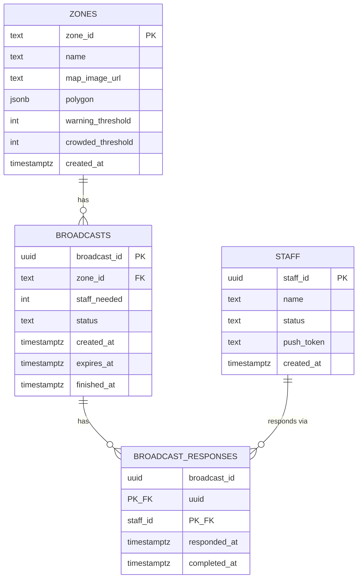
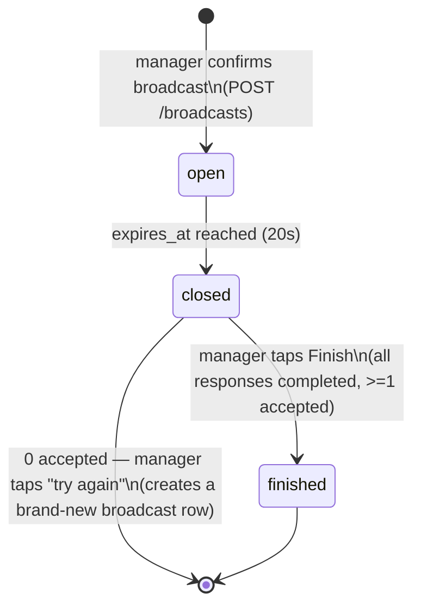
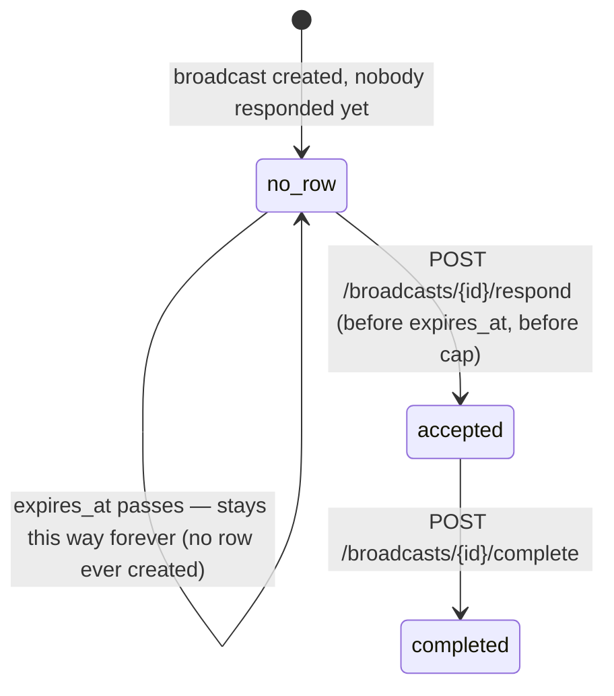

# Entity relationship diagram

Four tables. `zones` and `staff` are the nouns; `broadcasts` and `broadcast_responses`
are the workflow. See `README.md` for why `current_count`/`status` aren't columns here.

## Field notes

- `zones.zone_id` is **text**, not a generated UUID — it must match the `camera_id`
  already used in `elven-plong-be`'s `zones.json` (e.g. `"z1"`), so the two systems
  refer to the same zone without a mapping table.
- `zones.warning_threshold` / `crowded_threshold` are the two numbers that turn a raw
  `current_count` into the safe/warning/crowded status shown on manager page 1. Not
  derived from anything else — just configured per zone.
- `staff.status` is `idle | delegating`. It flips to `delegating` the moment a staff
  member accepts a broadcast, and back to `idle` the moment they tap "done
  delegation." It's the single source of truth the staff app's page 1 button
  (enabled/disabled) reads from.
- A row in `broadcast_responses` only exists for staff who **accepted**. A staff
  member who never responded, or whose accept arrived after the cap/deadline, simply
  has no row — there's no `response = 'ignored'` state to track, because this POC's
  flow has no consequence for not responding beyond "you weren't part of it."
- `broadcast_responses.completed_at` is `NULL` while that staff member is still
  actively delegating, and set the moment they tap "done delegation."

## Broadcast lifecycle

Two things worth calling out because they're easy to get wrong when implementing:

1. **"Try again" is not a state transition** — it doesn't reopen the same
   `broadcast_id`. It's a fresh `POST /broadcasts` with the same `zone_id` /
   `staff_needed`, producing a brand-new row. The old, zero-accepted broadcast just
   stays `closed` forever as a dead record.
2. **Only one `open` broadcast per `zone_id` at a time** — enforced at the DB level
   with a partial unique index (see `schema.sql`), not just application logic. This
   is what `POST /broadcasts` returning `409 broadcast_open` actually maps to.

## A staff member's response, as derived state

There's no explicit `status` column on `broadcast_responses` — the state is implied
by which timestamps are set. Useful to have written out plainly once:

`no_row` isn't a real database state — it's just "no `broadcast_responses` row for
this `(broadcast_id, staff_id)` pair exists." Shown here because the staff app needs
to represent it as a real UI state (the broadcast screen where nothing has happened
yet) even though the database has nothing to query for it.
